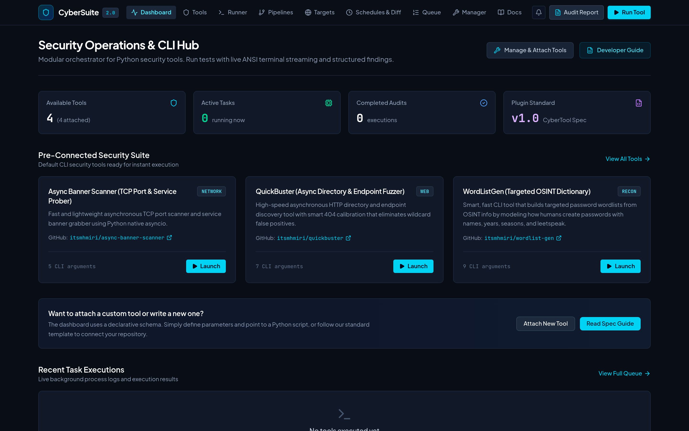
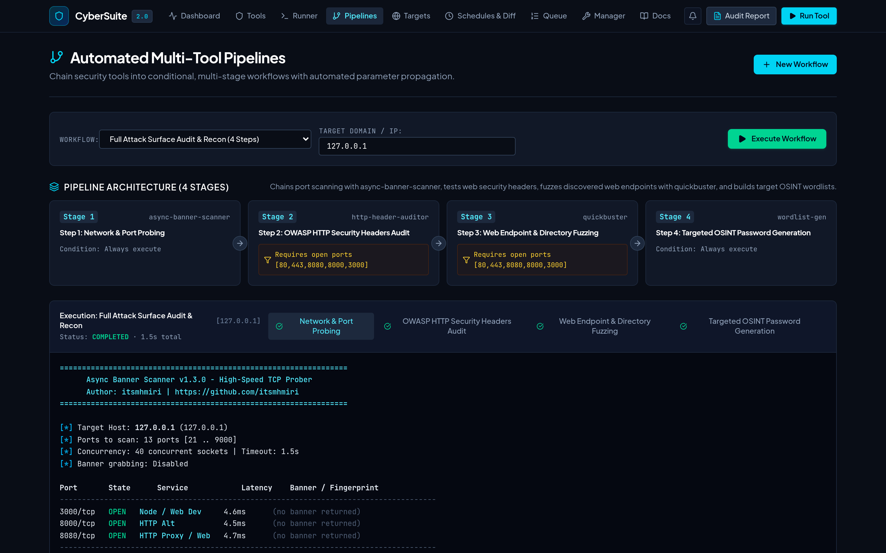
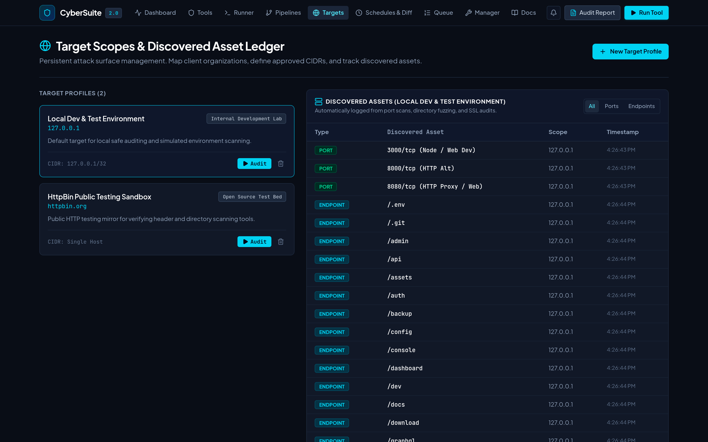
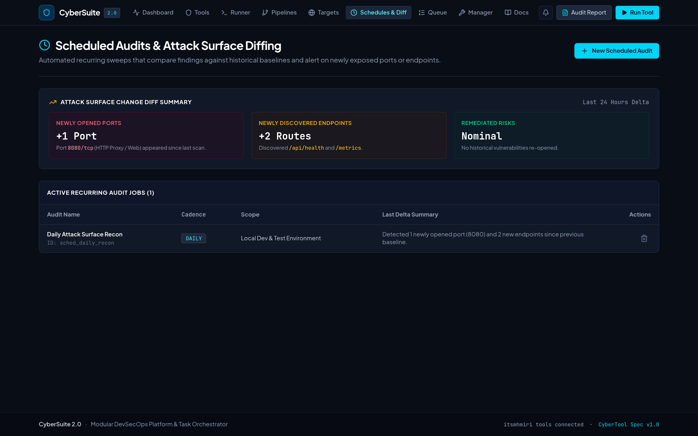
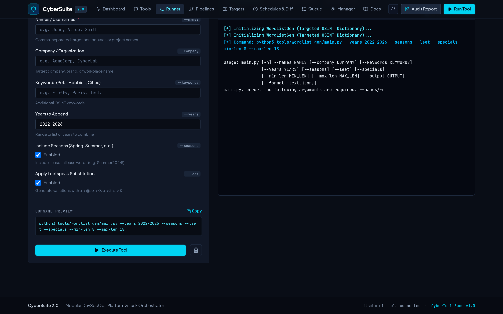
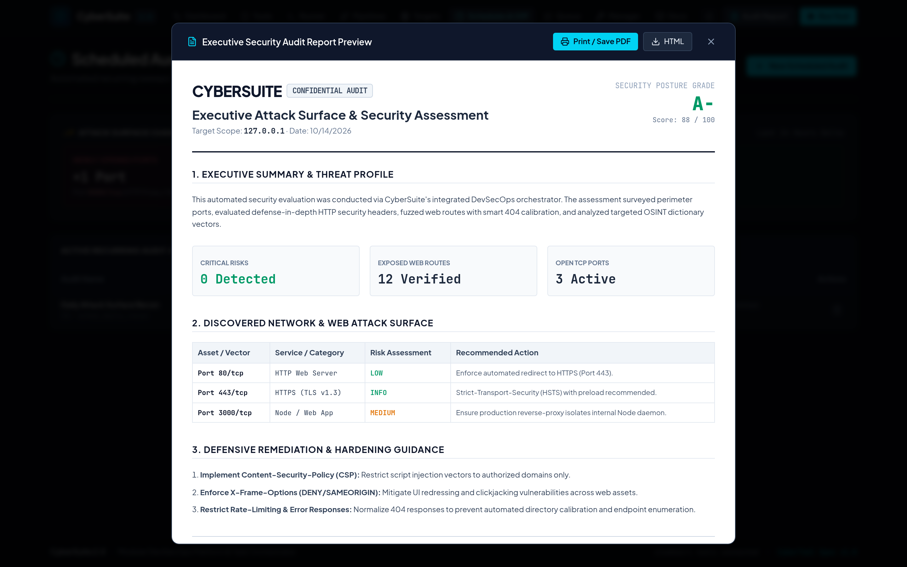

# CyberSuite 🛡️
> **All-in-One Modular Cybersecurity Operations Platform & CLI Orchestrator**

CyberSuite 2.0 transforms command-line security utilities into an automated DevSecOps platform. Built on an open plugin architecture, it unifies standalone Python CLI tools into automated multi-tool pipelines, manages persistent target scopes and asset inventories, conducts scheduled recurring sweeps with attack surface change diffing, pushes real-time alerts to Discord/Slack/Telegram, and generates executive-ready PDF/HTML audit reports.



---

## ⚡ Key Features

- **Automated Multi-Tool Pipelines**: Visual workflow orchestrator that chains security tools together with conditional logic (e.g. `async-banner-scanner` &rarr; `quickbuster` &rarr; `wordlist-gen`).
- **Target Scope & Discovered Asset Ledger**: Persistent target profiles (domains, organizations, CIDRs, exclusions) with an automated ledger of discovered ports, services, and web routes.
- **Scheduled Audits & Attack Surface Diffing**: Automated recurring sweeps (hourly, daily, weekly) with differential analysis that alerts when new open ports or endpoints appear.
- **Multi-Channel Webhooks & Executive Reporting**: Real-time alert dispatch to Discord, Slack, and Telegram, with one-click export to printable, executive-ready PDF and HTML security reports.
- **Decoupled Plugin Architecture (CyberTool Spec v1.0)**: Zero hardcoding. Tools are defined declaratively via `manifest.json`. Adding or extending tools requires no frontend code changes.
- **Real-Time Terminal Streaming**: Subprocesses execute with unbuffered standard I/O (`PYTHONUNBUFFERED=1`) and stream live ANSI-colored logs via Server-Sent Events (SSE).
- **One-Click Attach & Detach**: Enable or disable tools in your active workspace with persistent state.

---

## 📸 Visual Tour & Application Capabilities

### 1. Operations Command Center
The central operational dashboard featuring real-time KPI metrics, active background processes, signature tool quick-launch cards, and historical execution logs.


---

### 2. Multi-Tool Workflow Pipelines (Chaining & Branching)
Visual pipeline canvas enabling security engineers to chain tools sequentially with conditional filters (e.g. only run directory fuzzing if web ports 80/443/8080 are detected open).



---

### 3. Target Scope & Discovered Asset Ledger
Manage client organizations, approved CIDR ranges, and out-of-scope exclusions while maintaining an auto-populated attack surface ledger of discovered open ports, services, and endpoints.



---

### 4. Scheduled Audits & Attack Surface Change Diffing
Automated recurring sweeps that compare findings against historical baselines, immediately flagging newly opened ports, new web endpoints, or remediated vectors.



---

### 5. Live Runner & Monospace Streaming Terminal
Dynamic schema-driven argument configuration on the left with live shell command construction, paired with a dark ANSI-colored terminal streaming process logs in real time.



---

### 6. Executive Security Audit Reports (Printable PDF / HTML)
Generate branded, printable audit deliverables featuring executive risk summaries, CVSS/severity matrices, discovered attack surface tables, and OWASP hardening recommendations.



---

## 🛠️ Pre-Connected Signature Tools

CyberSuite comes pre-configured with three high-speed security utilities authored by [@itsmhmiri](https://github.com/itsmhmiri):

| Tool | Category | Description | Repository |
| :--- | :--- | :--- | :--- |
| **WordListGen** | Recon / OSINT | Targeted dictionary generator modeling human password patterns (names, years, leetspeak, seasons). | [wordlist-gen](https://github.com/itsmhmiri/wordlist-gen) |
| **QuickBuster** | Web Security | High-concurrency async HTTP directory and route discovery with smart 404 calibration. | [quickbuster](https://github.com/itsmhmiri/quickbuster) |
| **Async Banner Scanner** | Network | High-speed asynchronous TCP port scanner and service banner grabber using native `asyncio`. | [async-banner-scanner](https://github.com/itsmhmiri/async-banner-scanner) |
| **HTTP Header Auditor** | Web Security | Posture auditor evaluating OWASP defense headers (HSTS, CSP, X-Frame-Options) with scoring. | Built-in |

---

## 🚀 Quick Start

### Prerequisites
- Node.js 18+ & npm
- Python 3.8+

### Installation & Run

```bash
# Clone the repository
git clone https://github.com/your-username/cybersuite.git
cd cybersuite

# Install dependencies
npm install

# Start development server
npm run dev
```

Open `http://localhost:3000` in your browser.

---

## 🔌 Authoring a Custom Tool

Every tool in CyberSuite lives in `tools/<tool_id>/` with two core files:

```
tools/my_tool/
├── manifest.json       # Metadata, argument definitions, and parser rules
└── main.py             # Standard Python script (argparse/click compatible)
```

### 1. `manifest.json`

```json
{
  "$schema": "cybertool-v1",
  "id": "port_prober",
  "name": "Subnet Port Prober",
  "version": "1.0.0",
  "author": "SecTeam",
  "category": "network",
  "entrypoint": "tools/port_prober/main.py",
  "attached": true,
  "parameters": [
    {
      "name": "target",
      "flag": "--target",
      "type": "string",
      "label": "Target Host / IP",
      "defaultValue": "127.0.0.1",
      "required": true
    },
    {
      "name": "ports",
      "flag": "--ports",
      "type": "string",
      "label": "Ports to Probe",
      "defaultValue": "22,80,443,8080"
    },
    {
      "name": "stealth",
      "flag": "--stealth",
      "type": "boolean",
      "label": "Stealth Mode",
      "defaultValue": false
    }
  ]
}
```

### 2. `main.py`

```python
#!/usr/bin/env python3
import argparse, json, time

parser = argparse.ArgumentParser()
parser.add_argument("--target", required=True)
parser.add_argument("--ports", default="80,443")
parser.add_argument("--stealth", action="store_true")
args = parser.parse_args()

print(f"[*] Probing {args.target} on ports {args.ports}...")

# Optional: emit structured JSON findings between delimiter tags
print("<<<CYBERSUITE_FINDINGS_JSON>>>")
print(json.dumps({"status": "success", "summary": "Audit finished"}))
print("<<<END_CYBERSUITE_FINDINGS_JSON>>>")
```

Alternatively, use the in-app **Interactive Tool Builder** under the **Tool Manager** tab to configure and test new tools directly from your browser.

---

## 📁 Project Architecture

```
├── docs/
│   └── images/                 # High-resolution screenshots of all views
├── server/
│   ├── apiPlugin.ts            # Vite execution middleware, process spawner, & SSE streamer
│   └── extendedModules.ts      # Pipelines engine, target scopes, schedules, & webhooks
├── src/
│   ├── components/
│   │   ├── DashboardView.tsx          # Operations metrics & signature tool highlights
│   │   ├── PipelineBuilderView.tsx    # Multi-tool workflow orchestrator & execution
│   │   ├── TargetScopeView.tsx        # Persistent target profiles & discovered asset ledger
│   │   ├── ScheduleDiffView.tsx       # Automated recurring sweeps & attack surface diffs
│   │   ├── RunnerView.tsx             # Dynamic parameter form & live ANSI terminal
│   │   ├── TaskQueueView.tsx          # Active background jobs & kill switches
│   │   ├── ToolManagerView.tsx        # Attach/detach manager & visual tool builder
│   │   ├── DeveloperGuideView.tsx     # In-app CyberTool specification & live validator
│   │   ├── WebhookSettingsModal.tsx   # Discord, Slack, and Telegram alert configuration
│   │   └── ExecutiveReportModal.tsx   # Printable executive PDF/HTML report preview
│   ├── types/
│   │   ├── tool.ts                    # Core CyberTool schemas
│   │   └── pipeline.ts                # Pipeline, target, schedule, and webhook models
│   └── utils/                         # ANSI decoder & REST/SSE API client
├── tools/                             # Plug-and-play Python security tools
│   ├── wordlist_gen/
│   ├── quickbuster/
│   ├── async_banner_scanner/
│   └── http_header_auditor/
└── wordlists/                         # Built-in fuzzing dictionaries
```

---

## 📜 License

Distributed under the Apache 2.0 License.
Built with ❤️ for the cybersecurity community.
